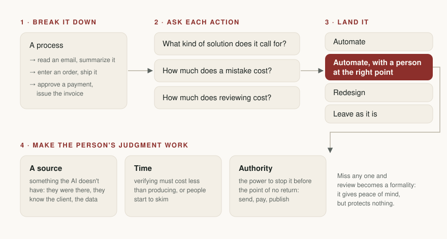

<p align="center">
  
</p>

# The Rising Cost of Judgment

**An essay on where human judgment belongs when AI makes answers free, and a method (the Vernuli Matrix) for deciding what to automate.**

**Read it:** [English](https://didierguisland.github.io/the-rising-cost-of-judgment/en/) · [Español](https://didierguisland.github.io/the-rising-cost-of-judgment/es/) · PDF: [EN](en/The-Rising-Cost-of-Judgment.pdf) / [ES](es/El-encarecimiento-del-juicio.pdf)

## The argument in four lines

1. Accountants and auditors went from about 856,000 to about 1.58 million between 1982 and 2024, while bookkeeping and accounting clerks changed little; the occupational classifications were not identical. Jeff Eyet's reading is that the work moved from arithmetic to judgment. The essay asks how AI is changing the first draft.
2. So before automating, the question isn't *"what can AI do?"* but *"how much does it cost to get it wrong, and where do we need to be to prevent it?"*
3. A person in the loop only protects anything if they have **a source the AI doesn't have, the time to use it, and the authority to stop it**. Miss one and review becomes a formality.
4. Left alone, judgment ends up at the end by default, where the work already looks finished and reviewers read to approve, not to question. Judgment also lives *in the middle*, in the turns along the way.

## The Vernuli Matrix

Break a process into concrete actions and ask each one three questions:

| Question | Why it matters |
|---|---|
| What kind of solution does it call for? | Clear rule + organized data → a simple integration. Messy input + fixed-shape output → AI. |
| How much does a mistake cost? | Some errors can still be caught; others go straight to a point of no return (send, pay, publish). |
| How much does reviewing cost? | A task is only worth automating if verifying the result costs less than producing it. |

Each action lands in one of four outcomes: **automate**, **automate with a person at the right point**, **redesign**, or **leave as it is**. → [Full method page](https://didierguisland.github.io/the-rising-cost-of-judgment/matrix/)

## Evidence

The essay draws on 12 sourced notes (Morgan Stanley, the Anchorage police, a Chevrolet dealership chatbot, CNET, a sanctioned law firm, a refunded government report, studies from the UK, P&G and Kenya) and one case built by the author: an [AI video production line](https://github.com/didierguisland/ai-video-factory) where moving review from the finished animation (~$7 to fix) to the storyboard (~$1.20) changed how the whole system was designed.

## Repository

```
en/        English essay (HTML + PDF)
es/        Spanish original (HTML + PDF)
matrix/    The Vernuli Matrix, method page
assets/    Shared styles and the Matrix diagram
```

The site is plain HTML and CSS, served with GitHub Pages. No build step.

## About

Written by **Didier Guisland** (Mexico City, November 2026). Business & finance background, UC Berkeley Technology Leadership & AI (Summer 2026), co-founder of Vernuli. The essay grew out of conversations with Jeff Eyet, my professor at Berkeley; his ideas are credited in the text and notes.

## License

Text and diagrams: [CC BY 4.0](LICENSE). Quoted third-party material remains with its respective owners.
